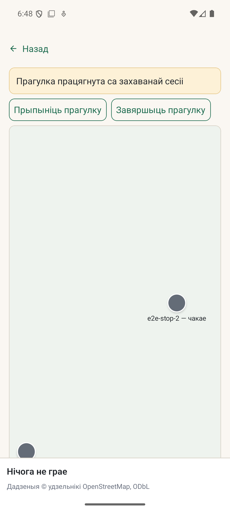
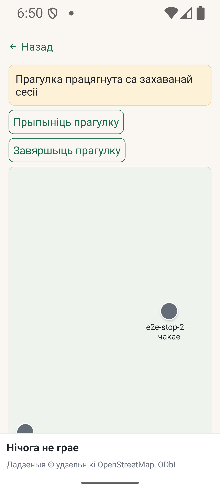

# #719 — перанос кнопак прагулкі пры вялікім шрыфце

*2026-10-11T19:32:07Z by Showboat 0.6.1*
<!-- showboat-id: 7179775a-1fd6-4bd6-a74b-89e01b0ac89c -->

Доказы захаваныя з прагону ZCode 2026-10-11; паўторны запуск AVD не заяўляецца. Кадры `run-resumed-scale1.png` і `run-resumed-scale2.png` паказваюць актыўныя кнопкі пры 100% і 200%. Назва `card-open` была памылковай і выпраўленая на `resumed`. Межы праверкі апісаныя ў `docs/agent-tasks/results/G21.47-follow-up.md`.

```bash
node --test --test-isolation=none test/actions-row-evidence.test.mjs > /tmp/kudy719-evidence-proof.log 2>&1 && echo 'Saved device evidence and cleanup checks: PASS'
```

```output
Saved device evidence and cleanup checks: PASS
```

```bash
node node_modules/jest/bin/jest.js --config jest.config.js app/run.test.tsx -t 'pinned 200%' --runInBand > /tmp/kudy719-render-proof.log 2>&1 && echo 'Run render at pinned 200%: PASS'
```

```output
Run render at pinned 200%: PASS
```




