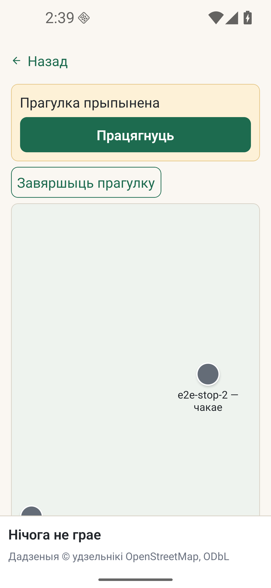

# Android: праверкі моў, кнопак і аднаўлення налад

*2026-10-12T00:17:36Z by Showboat 0.6.1*
<!-- showboat-id: 79396272-22db-4334-9546-cd62eec6c588 -->

Гэты паўторны доказ запускае праверкі парсера Android, выбару мовы, межаў кнопак,
ачысткі працэсаў і аднаўлення памеру шрыфту. Асобны жывы прагон васьмі моў і Run
на эмулятары даў 17/17; каманда і адмоўная праверка захавання мовы запісаны ў
[выніках G23.07](../agent-tasks/results/G23.07.md). Здымак ніжэй атрыманы падчас
гэтага жывога прагона пры font scale 1.5.

```bash
node --no-warnings --test --test-reporter=dot tools/e2e-android/driver.test.mjs tools/e2e-android/locales.test.mjs tools/e2e-android/wiring.test.mjs
```

```output
....................
.............
```

```bash {image}

```


