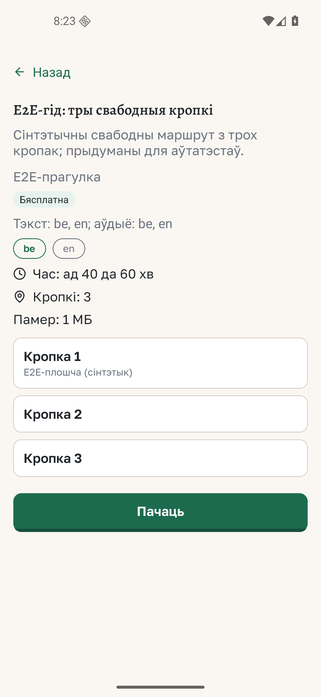

# Guide preview theme from discovery

*2026-10-12T18:24:02Z by Showboat 0.6.1*
<!-- showboat-id: 03fd8878-28cd-4d03-a3a0-e72a53abde69 -->

The focused catalog service suite checks theme projection from the pinned index, locale selection, and absent or unknown themes. The Android screenshot below shows the synthetic G23.01 guide with its published Belarusian theme.

```bash
set -o pipefail; node --test --experimental-strip-types --experimental-test-module-mocks --test-reporter=spec services/catalog/catalogService.test.ts 2>&1 | rg 'projects the free E2E guide theme|omits unknown and unlabeled theme IDs|ℹ (tests|pass|fail)' | sed -E 's/ \([0-9.]+ms\)//'
```

```output
  ✔ projects the free E2E guide theme from the pinned discovery index in the selected locale
  ✔ omits unknown and unlabeled theme IDs without inventing a label or fetching another file
ℹ tests 42
ℹ pass 42
ℹ fail 0
```

```bash {image}

```


