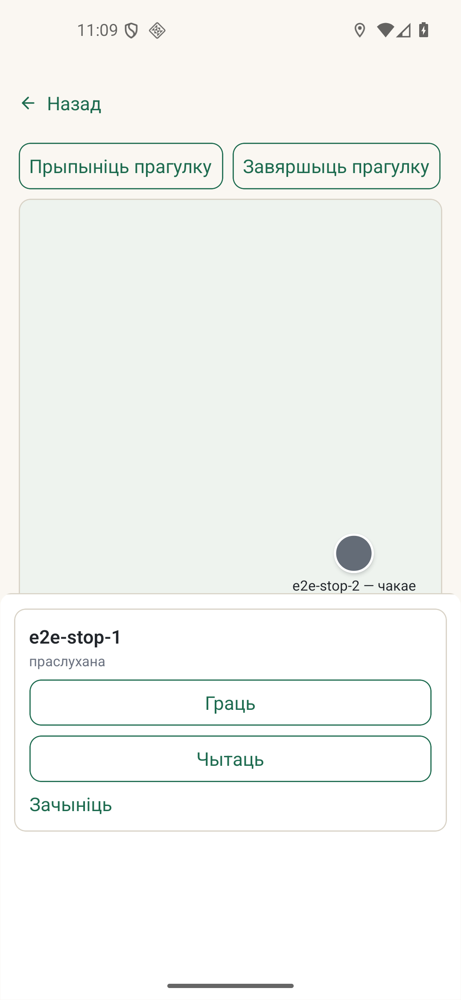

# Issue #749 — Android audio URI and SQLite cursor release

*2026-10-13T21:10:37Z by Showboat 0.6.1*
<!-- showboat-id: f5a238d2-781f-4529-a73e-62ff2557e7e5 -->

Сінтэтычны пакет правярае URI гіда і моманту праз вытворчы рэзолвэр; SQLite-тэст правярае вызваленне курсора перад транзакцыяй. На эмулятары Android 16 пасля свежай загрузкі першая кропка перайшла ў «праслухана» (скрыншот ніжэй).

```python3
import os, pathlib, subprocess
names = (
    'G23.04-P3: guide and session Moment use the injected device audio URI boundary',
    'G23.04-P3: an absent device audio file uses the existing failed-play transition',
    'audio URI resolution stays inside downloaded, nonempty bundle files',
    'read and write statements release their cursor before a transaction starts',
)
env = dict(os.environ, LD_LIBRARY_PATH=str(pathlib.Path.home() / '.local' / 'lib'))
run = subprocess.run(
    ['node', '--experimental-strip-types', '--experimental-test-module-mocks', '--test',
     '--test-reporter=tap', 'controllers/run/runSurfaceController.test.ts',
     'services/contentRepo/expo/expo-package-store.test.ts',
     'services/db/expo/expo-sqlite-driver.test.ts'],
    env=env, capture_output=True, text=True)
assert run.returncode == 0, run.stdout[-3000:] + run.stderr[-3000:]
for name in names:
    assert f' - {name}\n' in run.stdout, name
    print('PASS', name)

```

```output
PASS G23.04-P3: guide and session Moment use the injected device audio URI boundary
PASS G23.04-P3: an absent device audio file uses the existing failed-play transition
PASS audio URI resolution stays inside downloaded, nonempty bundle files
PASS read and write statements release their cursor before a transaction starts
```

```bash {image}

```


