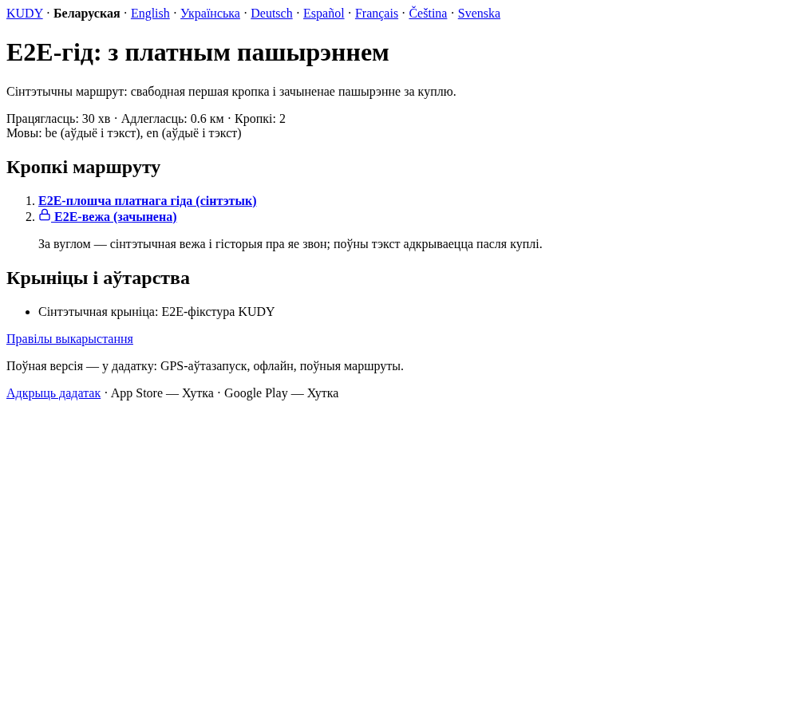

# Замок на зачыненай кропцы ў вэбе

*2026-10-13T23:07:07Z by Showboat 0.6.1*
<!-- showboat-id: 45dae5b0-af3d-4706-9b33-0afa94a96d9e -->

Сінтэтычны платны гід паказвае зацверджаную форму замка побач з зачыненай кропкай. Каманда рэндэрыць сапраўдны кампанент для кожнай выпушчанай мовы інтэрфейсу і падае, калі прыбраць SVG або вярнуць эмодзі.

```bash
set -o pipefail; node --test --experimental-strip-types web/components/locked-stop-row.test.ts 2>&1 | rg 'locked stop icon|ℹ (tests|pass|fail)' | sed -E 's/ \([0-9.]+ms\)//'
```

```output
✔ locked stop icon uses every released locale label without changing the public preview
ℹ tests 1
ℹ pass 1
ℹ fail 0
```

```bash {image}

```


