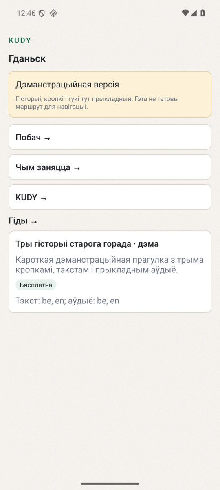
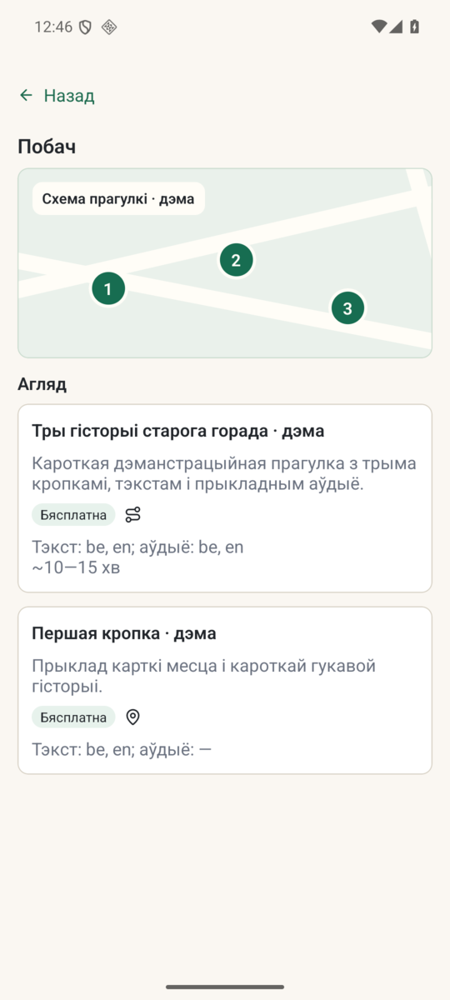
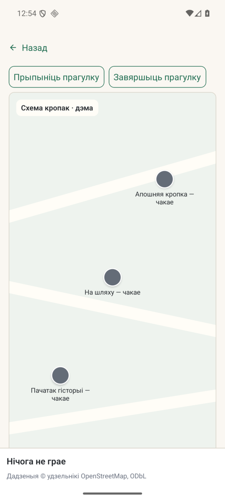

# Offline Android demo

*2026-10-15T10:31:09Z by Showboat 0.6.1*
<!-- showboat-id: d4544862-77ac-4880-a2db-d1272fbc733c -->

Аўтаномная дэманстрацыйная версія выкарыстоўвае ўбудаваны валідны каталог. Яна ўсталёўваецца асобна ад асноўнага дадатка; выдуманы кантэнт пазначаны на галоўным экране.

```sh
node tools/demo/build-demo.mjs --check
```

```output
demo catalog: 27 published files
```

```sh
node --test --experimental-strip-types test/demo-catalog.test.mjs 2>&1 | grep -E "^ℹ (tests|pass|fail) "
```

```output
ℹ tests 5
ℹ pass 5
ℹ fail 0
```

На Android-эмулятары праверана ўсталёўка асобнага пакета `by.kudy.app.demo`, адкрыццё галоўнага экрана, «Побач», прэв'ю гіда, загрузка ўбудаванага пакета і пачатак прагулкі. На экранах відавочна пазначаны дэма-кантэнт і схематычная карта.






