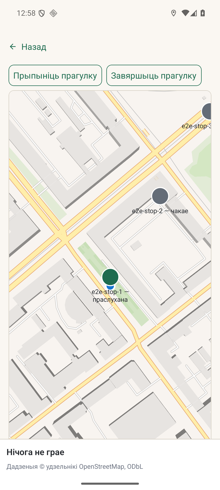

# Мабільная карта прагулкі

*2026-10-15T22:47:43Z by Showboat 0.6.1*
<!-- showboat-id: 88379ae8-1adb-43dc-baaf-180b59f2490b -->

Натыўная карта выкарыстоўвае каардынаты кропак маршруту. Яе камера чытае ўжо існуючы GPS-паток праз кантролер; рэзкія скачкі і недакладныя фіксы адкідае кананічны pipeline. Калі геаметрыі няма або тайлы не загрузіліся, застаецца схема.

На Android 36 у эмулятары `kudy-test` натыўная карта паказала вуліцы, маркеры і бягучую пазіцыю для сінтэтычнага маршруту. Здымак зроблены падчас E2E-сцэнарыя прагулкі.



```bash
set -o pipefail
node --test --experimental-strip-types controllers/run/runMap.test.ts 2>/dev/null | sed -n "s/^✔ camera uses the walk pipeline:.*/GPS spike: rejected/p"
```

```output
GPS spike: rejected
```

```bash
set -o pipefail
npx jest --config jest.config.js components/run-native-map.test.tsx --runInBand --silent 2>&1 | sed -n "s/^PASS components\/run-native-map.test.tsx.*/Native map interaction: PASS/p"
```

```output
Native map interaction: PASS
```
