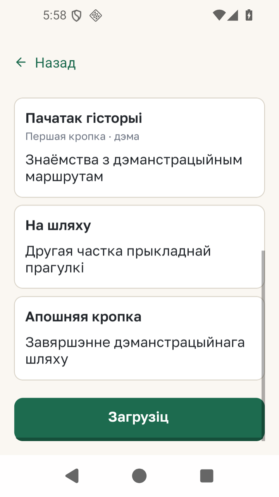

# APR-05 — бяспечныя межы Android

*2026-10-18T13:21:58Z by Showboat 0.6.1*
<!-- showboat-id: 80aac3e3-6bdc-48ec-8531-080cb05eb70a -->

Рэндэр-тэст правярае ніжні inset на вузкім экране 320 dp для Explore, Guides, прэв’ю, Nearby, My KUDY, Place, Collection, Discovery і Feedback. Да першай праўкі пяць праверак падалі; перад праўкай астатніх чатырох яны таксама падалі. Верхнія межы і ніжняя панэль Run правяраюцца тымі ж Jest-наборамі.

```bash
set -o pipefail; node_modules/.bin/jest --config jest.config.js --runInBand app/safe-area.test.tsx app/run.test.tsx 2>&1 | grep -E "^(Test Suites:|Tests:)"
```

```output
Test Suites: 2 passed, 2 total
Tests:       64 passed, 64 total
```

Release-выгляд на Android 16 з трохкнопкавай навігацыяй у акне 720×1280: пасля пракруткі апошняя картка і дзеянне прэв’ю застаюцца над сістэмнай панэллю.



Поўная матрыца Android 15/16 і двух рэжымаў навігацыі — у [выніках APR-05](../agent-tasks/results/APR-05.md).
