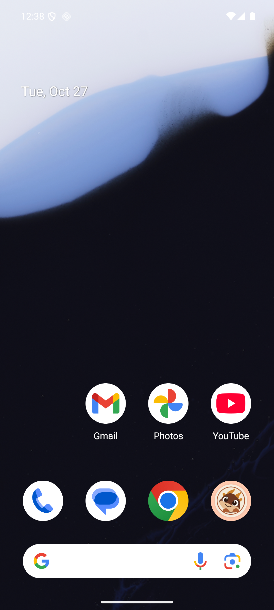
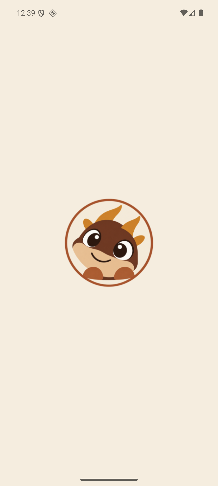

# Issue #429: брэнд-іконка і splash на лаўнчары

*Showboat demo задачи #429 (гейчана асетам уладара): app.json не задаваў
ні icon, ні adaptiveIcon, ні splash — на ўстаноўцы і ў Dev Launcher быў
дэфолтны Expo-робат. Інтэграцыя прынятага пакета
`app-icon-copper-framed-v1` («медны дракон з абрамленнем», рашэнне
заснавальніка ад 2026-10-26 у #429): асеты ў `assets/kudy-icon/`, палі
іконак і splash у app.json, дэма-канфіг трымае сваю іконку. Створана
2026-10-26.*

<!-- showboat-id: issue429-icon-splash -->

Крытэр 1 — канфігурацыя брэнда ў app.json: усе тры узроўні іконкі
(квоты Expo, iOS, Android), абодва слоі adaptive (foreground +
background) і splash са светлай крэмавай падкладкай.

```sh
LD_LIBRARY_PATH=$HOME/.local/lib node -e '
const c = require("./app.json").expo;
console.log("expo.icon =", c.icon);
console.log("expo.ios.icon =", c.ios.icon);
console.log("expo.android.icon =", c.android.icon);
console.log("adaptiveIcon.foregroundImage =", c.android.adaptiveIcon.foregroundImage);
console.log("adaptiveIcon.backgroundImage =", c.android.adaptiveIcon.backgroundImage);
console.log("adaptiveIcon.backgroundColor =", c.android.adaptiveIcon.backgroundColor);
console.log("splash =", JSON.stringify(c.splash));
'
```

```output
expo.icon = ./assets/kudy-icon/icon.png
expo.ios.icon = ./assets/kudy-icon/icon.png
expo.android.icon = ./assets/kudy-icon/icon.png
adaptiveIcon.foregroundImage = ./assets/kudy-icon/android-adaptive-foreground.png
adaptiveIcon.backgroundImage = ./assets/kudy-icon/android-adaptive-background.png
adaptiveIcon.backgroundColor = #F5EDDF
splash = {"image":"./assets/kudy-icon/icon.png","resizeMode":"contain","backgroundColor":"#F5EDDF"}
```

Рэпа нясе дакладна тыя байты, што прыняў уладар: кантрольныя сумы трох
асетаў супадаюць з `SHA256SUMS` пакета `app-icon-copper-framed-v1`
(перо-праверка зборкі пакета — у `docs/agent-tasks/results/429.md`).

```sh
sha256sum assets/kudy-icon/icon.png assets/kudy-icon/android-adaptive-foreground.png assets/kudy-icon/android-adaptive-background.png
```

```output
3813f1f2be73e6368a3e805e434f18d4e353ca7fce0b8aa8188a2491383285bf  assets/kudy-icon/icon.png
e0e2f4e3fd537a459b01163d83f3bcb40f22ca79973503d6b6f9225a827af215  assets/kudy-icon/android-adaptive-foreground.png
bdff7b4e90f5aa916fffd99d67b74c609a07fab4e5cf30cbe298b3993380efe1  assets/kudy-icon/android-adaptive-background.png
```

Дэма-зборка (асобны APK) не спадкуе вытворчую лаўнчар-іконку: свая
іконка, свой package, adaptive зняты — інакчам дэма замяніла б сабе на
лаўнчары сапраўдную іконку KUDY. Брэнд-splash дэма свядома спадкавала
(застаўка брэндовая ва ўсіх зборках); гэта замацаванае трэцім тэстам
гарда.

```sh
EXPO_PUBLIC_DEMO_MODE=1 LD_LIBRARY_PATH=$HOME/.local/lib node -e '
const c = require("./app.config.js").expo;
console.log("demo.name =", c.name);
console.log("demo.icon =", c.icon);
console.log("demo.android.package =", c.android.package);
console.log("demo.android.icon =", c.android.icon);
console.log("demo.android.adaptiveIcon =", c.android.adaptiveIcon);
console.log("demo.ios.icon =", c.ios.icon);
'
```

```output
demo.name = KUDY Demo
demo.icon = ./assets/demo-icon.png
demo.android.package = by.kudy.app.demo
demo.android.icon = ./assets/demo-icon.png
demo.android.adaptiveIcon = undefined
demo.ios.icon = ./assets/demo-icon.png
```

Гард, падае пры адкаце (implementation-rules 1): `test/app-icon-config.test.mjs`
мацуе ўсе палі канфігу, існаванне кожнага ацэта на дыску і дэма-перавызначэнні.
Рэверт-эксперымент: скрыпт здымае з app.json поле вытворчай іконкі і splash
(з гардам «нічога не знята»), тэст чырвоны; аднаўленне файла — зелёны.

```sh
cp app.json /tmp/showboat-429-app.json.bak
LD_LIBRARY_PATH=$HOME/.local/lib node -e '
const fs = require("node:fs");
const before = fs.readFileSync("app.json", "utf8");
const after = before.replace(/,\n    "icon": "\.\/assets\/kudy-icon\/icon\.png",\n    "splash": \{[^{}]*\}/, "");
if (after === before) { console.error("nothing removed"); process.exit(1); }
fs.writeFileSync("app.json", after);
console.log("removed the brand icon and splash fields");
'
LD_LIBRARY_PATH=$HOME/.local/lib node --test --experimental-strip-types test/app-icon-config.test.mjs 2>&1 | grep -E "^ℹ (pass|fail)"
cp /tmp/showboat-429-app.json.bak app.json
LD_LIBRARY_PATH=$HOME/.local/lib node --test --experimental-strip-types test/app-icon-config.test.mjs 2>&1 | grep -E "^ℹ (pass|fail)"
```

```output
removed the brand icon and splash fields
ℹ pass 1
ℹ fail 2
ℹ pass 3
ℹ fail 0
```

Крытэр 2 — жывы лаўнчар эмулятара з новай іконкай: dev-client
сабраны з гэтай галінкі (expo prebuild + gradle assembleDebug,
эмулятар kudy-test), устаноўка і хатні экран:



Кроп іконкі з дока — абрамленне і мордачка чытаюцца і ў мініяцюры:


Splash на халодным старце таго ж APK: крэмавы фон з прынятай
іконкай па цэнтры (Android 12+ splash з `splashscreen_background`).


