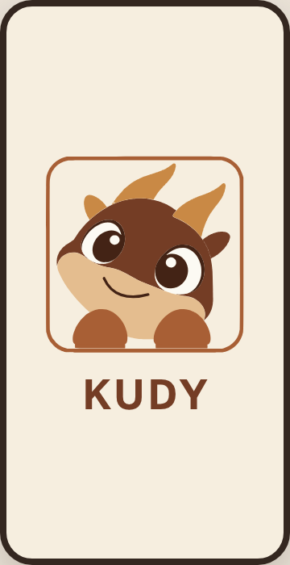

# Анімаваны ўваход KUDY

*2026-10-28T14:16:04Z by Showboat 0.6.1*
<!-- showboat-id: 74f57352-4af0-4375-a47f-88eb5265ca8b -->

Анімаваны экран выкарыстоўвае захаваныя SVG-контуры. Тэсты правяраюць чаргу лап, галавы, міргання з рыўком, рота і надпісу, пасля якой адкрываецца Explore. Пры паменшаным руху адкрываецца Explore без анімацыі.

```bash
set -o pipefail; npx jest --config jest.config.js --runInBand app/animated-splash.test.tsx app/animated-splash-reduced-motion.test.tsx app/navigation.test.tsx 2>&1 | grep -E "^Test Suites:|^Tests:"
```

```output
Test Suites: 3 passed, 3 total
Tests:       24 passed, 24 total
```

Кадр ніжэй — зацверджаны HTML-прататып як візуальны арыенцір. Жывы выгляд React Native на прыладзе пакуль не правераны.

```bash {image}
6fcd9321-2026-10-28.png
```


