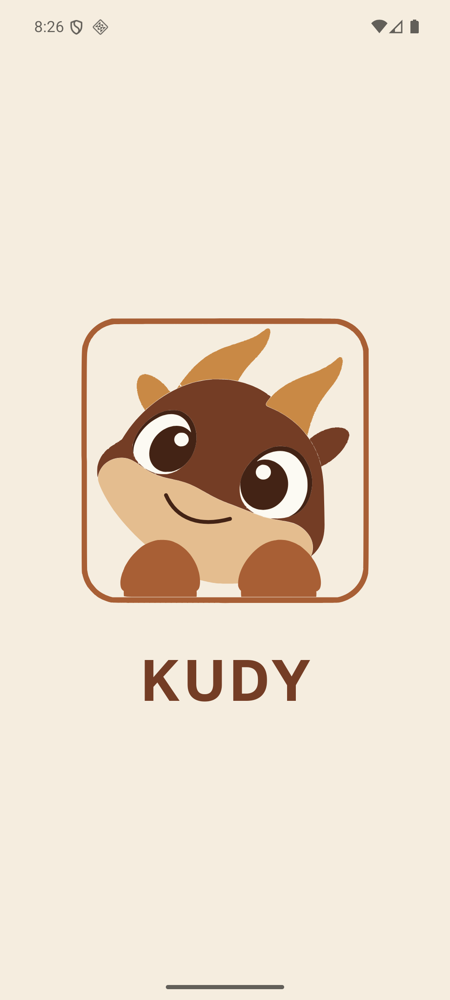

# Splash: слова «KUDY» абразалася да «KUD» (2026-10-28)

Заўвага заснавальніка: на эмулятары заставка паказвала «KUD» — літара «Y»
знікала цалкам. Прычына: брэндавы радок быў скрынкай па шырыні слова, і гэту
шырыню Yoga адмераў у момант мантавання, калі GolosText яшчэ не падгрузіўся
(сістэмны фолбэк вузейшы). Калі GolosText даходзіў, Android пераносіў шырэйшае
слова ўнутры старой аднарадковай скрынкі — «Y» трапляў на другі радок, які
скрынка абразала па вышыні. Цяпер радок бярэ поўную шырыню экрана з
цэнтраваным чарнілам: на правераным AVD перанос знік пры любой падмене
шрыфту. Абсяг доказу абмежаваны гэтым экранам і стандартным маштабам
шрыфту: пры вялікім сістэмным маштабаванні ці значна вузейшым экране
поўная шырыня перанос не забараняе, такі выпадак дэма не ахоплівае.

<!-- showboat-id: splash-brand-clip-2026-10-28 -->

Гард, які падае пры адкаце brand-стылю да памеру па кантэнце
(`width: "100%"`, `textAlign: "center"` у `components/animated-splash.tsx`):

```sh
LD_LIBRARY_PATH=$HOME/.local/lib npx jest --config jest.config.js app/animated-splash.test.tsx app/animated-splash-reduced-motion.test.tsx 2>&1 | grep -E "^(PASS|FAIL)|^(Tests|Test Suites|Snapshots):" | sed -E 's/ \([0-9.]+ (s|ms)\)$//' | LC_ALL=C sort
```

```output
PASS app/animated-splash-reduced-motion.test.tsx
PASS app/animated-splash.test.tsx
Snapshots:   0 total
Test Suites: 2 passed, 2 total
Tests:       4 passed, 4 total
```

Вывад каманды нармалізаваны, каб гард не залежаў ад машыны: jest дадае
`(NN.NNN s)` толькі да марудных сьютаў (на халодным кэшы тут каля 26 с) і
друкуе сьюты ў парадку завяршэння, таму `sed` адкідвае таймінгі, а
`LC_ALL=C sort` уніфікаваў парадак радкоў — запісаны блок супадае з вывадам
і на цёплым, і на халодным прагоне.

Доказ на эмулятары (AVD kudy-test, 1080 × 2400, density 2.625): да фікса
uiautomator паказваў тэкставую скрынку `[354,1556][725,1701]` — 371 px,
а чарніла надпісу 291 px («KUD»); пасля фікса скрынка `[0,1556][1080,1701]`
— поўная шырыня, чарніла 395 px («KUDY» па цэнтры). Аднаўзаемны прагон:

```sh
adb -s emulator-5554 shell am force-stop by.kudy.app && adb -s emulator-5554 shell am start -n by.kudy.app/.MainActivity
```




Заўвага асяроддзя (2026-10-28): Metro, які ўжо працаваў, не заўважыў лакальных
правак файлаў (watcher у сэсіі, што трымае Metro, не атрымаў івентаў), таму
dev-client працягваў атрымліваць замёрзлы граф; каб убачыць змену на
эмулятары, патрабаваўся перазапуск Metro (`systemctl --user restart
kudy-metro`) — пасля яго даўжыня чарніла маркі змянілася з 291 px на 395 px.
