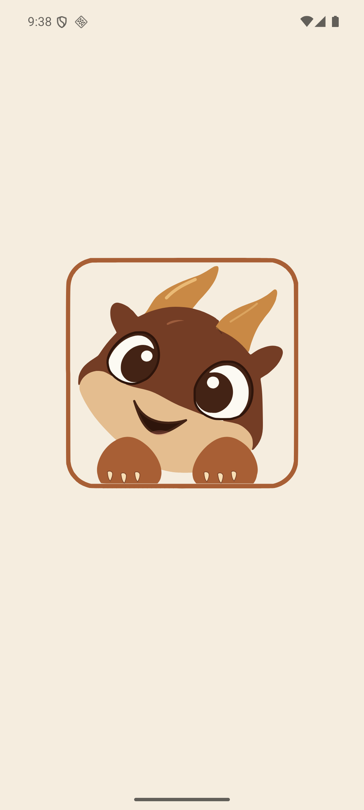
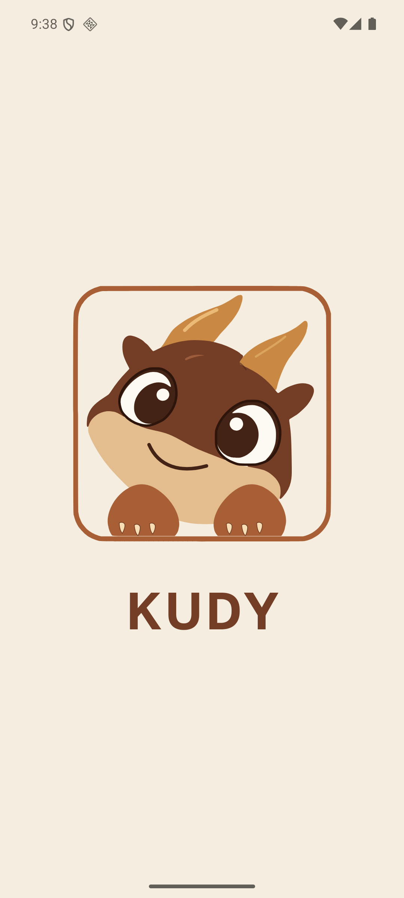

# Вектарная застаўка KUDY: V6

*2026-10-28T20:37:45Z by Showboat 0.6.1*
<!-- showboat-id: 40cababc-cfa7-4f52-a50a-692516f75019 -->

Зацверджаныя контуры V6 убудаваныя ў экран уваходу. Кіпцікі абедзвюх лап і суцэльная абводка вачэй правяраюцца аўтаматычна. Кадры ніжэй знятыя з Android-эмулятара падчас сапраўднага запуску праграмы.

```bash
./node_modules/.bin/jest --config jest.config.js --runInBand components/animated-splash-quality.test.tsx >/tmp/kudy-splash-proof-jest.log 2>&1 && echo "Прыёмныя праверкі застаўкі: PASS (2/2)"
```

```output
Прыёмныя праверкі застаўкі: PASS (2/2)
```

```bash {image}
/tmp/kudy-v6-9.png
```



```bash {image}
/tmp/kudy-v6-10.png
```


