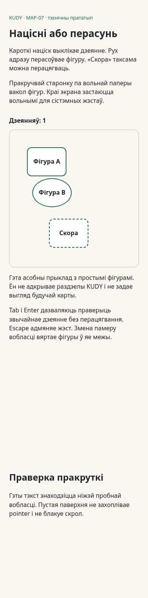

# MAP-07 — ізаляваны рухавік tap/drag

*2026-10-29T14:06:17Z by Showboat 0.6.1*
<!-- showboat-id: 8734cd97-524b-46cb-a234-ca5c8050e2a8 -->

Прыёмачныя тэсты замарожаныя незалежным аўтарам у 4ae22793243e59eb526598370a92d7ea91e92d9a. Прататып не падключаны да production home. Праверка ніжэй запускае той жа рухавік, які выкарыстоўвае браўзерны прыклад.

```bash
set -o pipefail; node --test --test-reporter=spec spikes/MAP-07-tap-drag/tap-drag.test.mjs spikes/MAP-07-tap-drag/edge-cases.test.mjs | sed -E "s/ \([0-9.]+ms\)//g; /duration_ms/d"
```

```output
✔ Final pointer sample, foreign events and returned snapshots cannot create accidental taps
✔ Invalid geometry is diagnosed; non-finite movement cannot corrupt the position
✔ AC1: a short tap tolerates small jitter and navigates exactly once
✔ AC1: crossing the threshold moves immediately and never becomes a tap again
▶ AC2: cancellation, lost capture and multi-touch suppress navigation and allow a fresh tap
  ✔ cancel, dragging=false
  ✔ cancel, dragging=true
  ✔ lostPointer, dragging=false
  ✔ lostPointer, dragging=true
  ✔ multitouch, dragging=false
  ✔ multitouch, dragging=true
✔ AC2: cancellation, lost capture and multi-touch suppress navigation and allow a fresh tap
✔ AC2: dragging keeps the whole fragment inside every safe boundary
✔ AC3: disabled fragments stay draggable while only enabled fragments navigate
ℹ tests 13
ℹ suites 0
ℹ pass 13
ℹ fail 0
ℹ cancelled 0
ℹ skipped 0
ℹ todo 0
```

```bash
node spikes/MAP-07-tap-drag/proof.mjs
```

```output
original: passed
disabled navigates: rejected
drag navigates: rejected
movement removed: rejected
```

Chromium правярае сапраўдныя pointer/touch падзеі, аднаразовы tap, disabled, Escape, страту capture, абмежаванне перамалёўкі адным кадрам, памяншэнне экрана і пракрутку па вольнай паверхні. Android/iOS back і native FPS тут не правераныя; падключанай ADB-прылады няма.

```bash
set -o pipefail; MAP07_BROWSER=1 node --test --test-reporter=spec spikes/MAP-07-tap-drag/browser.test.mjs | sed -E "s/ \([0-9.]+ms\)//g; /duration_ms/d"
```

```output
✔ MAP-07 browser: pointer, keyboard, cancellation, resize and touch scroll
ℹ tests 1
ℹ suites 0
ℹ pass 1
ℹ fail 0
ℹ cancelled 0
ℹ skipped 0
ℹ todo 0
```

```bash {image}

```


