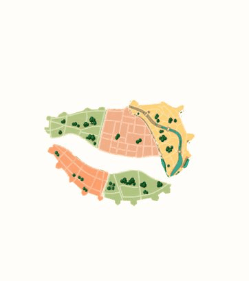

# Бурштынавае святло з плаўнымі ніткамі

*2026-10-31T16:25:26Z by Showboat 0.6.1*
<!-- showboat-id: cddb50d0-226e-4ef7-a098-60a1b436c507 -->

Уладальнік выбраў варыянт 1 і папрасіў тонкія павольныя ня вуглаватыя ніткі вакол карты. Агульны helper выкарыстоўваецца ў native і web; толькі эфект пасля апошняга карыстальніцкага стыку. Націскі і ручны магніт захаваныя. Браўзерны запіс ніжэй паказвае рух, не выдаецца за доказ запуску на фізічнай прыладзе. Metro Android/iOS правераныя асобна; Reduced Motion спыняе ніткі.

```powershell
node --disable-warning=MODULE_TYPELESS_PACKAGE_JSON --experimental-strip-types --test --test-reporter=dot docs/design/brand/outputs/menu-map-city-only/amber-light.test.mjs docs/design/brand/outputs/menu-map-city-only/magnet.test.mjs docs/design/brand/outputs/menu-map-city-only/native/model.test.mjs
```

```output
..........
```

```powershell
node docs/design/brand/outputs/menu-map-city-only/native/verify-component.mjs
```

```output
PASS: React Native responder and accessibility tests 4/4
```

```bash {image}

```


