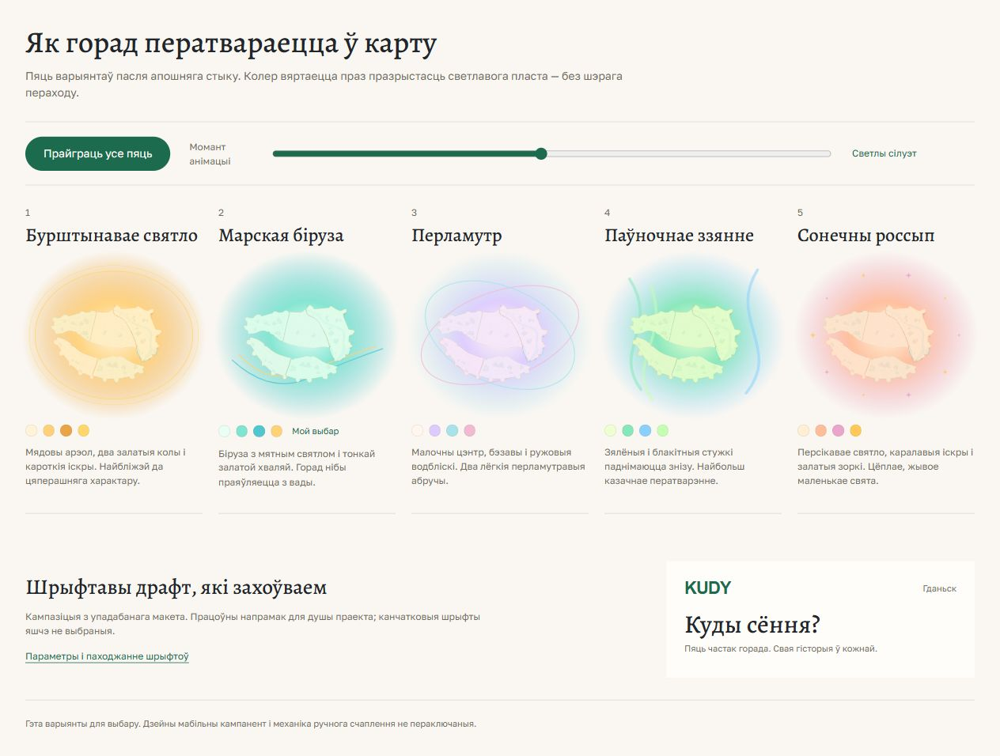

# Пяць прапаноў свячэння і шрыфтавы драфт

*2026-10-31T16:06:33Z by Showboat 0.6.1*
<!-- showboat-id: e08f5837-5b23-4f3a-8b6d-8162eb14f117 -->

Параўнанне пяці варыянтаў для выбару. Зыходны відэазапіс праглядзены лакальна; прыватны MP4 не капіраваўся ў рэпазіторый. У браўзеры правераны пяць варыянтаў, агульны паўзунок і адзін поўны цыкл да поўнай карты. Каляровы сілуэт праяўляецца асобным пластом, без інтэрпаляцыі фільтра brightness/invert. У atlas-brief.md захаваны ўпадабаны шрыфтавы ўзор як драфт, з дакладнымі файламі і іх паходжаннем; production-канон не зменены.

```powershell
node --input-type=module -e "const {variants,motion}=await import('./docs/design/brand/outputs/menu-glow-options/options.mjs'); console.log(variants.map(v=>v.title+': '+v.glow+' / '+v.edge).join(String.fromCharCode(10)));console.log(JSON.stringify(motion(.48)));console.log(JSON.stringify(motion(1)));"
```

```output
Бурштынавае святло: #ffd17b / #e8a447
Марская біруза: #80e4d1 / #52c6d0
Перламутр: #ddcbff / #a9e2eb
Паўночнае ззянне: #86e7ba / #8bcfff
Сонечны россып: #ffbd9c / #e9a5cb
{"t":0.48,"light":1,"veil":0.94,"radius":0,"phase":"Светлы сілуэт"}
{"t":1,"light":0,"veil":0,"radius":1000,"phase":"Поўная карта"}
```

```bash {image}

```



```bash {image}

```


