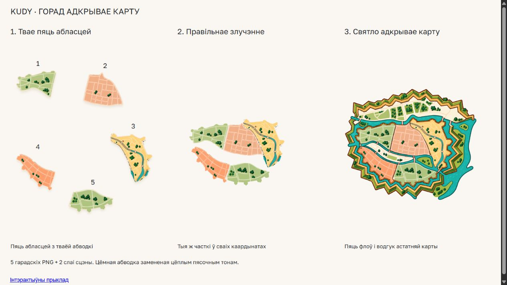

# Мабільны кампанент пяці гарадскіх частак

*2026-10-31T15:43:05Z by Showboat 0.6.1*
<!-- showboat-id: b12cfa45-c8fd-4ff9-bdb1-039259a48130 -->

Мабільны React Native-кампанент мае асобныя перакладзеныя назвы і onSelect(id). Магніт працуе толькі пры сапраўдным руху пасля ўтрымання. Сцэна дае водгук без onSelect. Чорная абводка ўнутры кавалкаў замененая цёплым тонам. Браўзерны здымак ніжэй паказвае асеты; native-паводзіны правярае сапраўдная responder-сюіта, не мок мадэлі. Metro Android/iOS сабраны; фізічная прылада не правяралася.

```powershell
& C:/Users/kamyl/AppData/Local/Python/pythoncore-3.14-64/python.exe -c "import sys, runpy; sys.stdout.reconfigure(newline=chr(10)); runpy.run_path('docs/design/brand/outputs/menu-map-city-only/verify.py')"
```

```output
PASS: owner regions 1-5; 11,390 ink pixels warmed; original geometry unchanged; all 1,143,233 styled pixels restored exactly.
```

```powershell
node --disable-warning=MODULE_TYPELESS_PACKAGE_JSON --experimental-strip-types --test --test-reporter=dot docs/design/brand/outputs/menu-map-city-only/native/model.test.mjs docs/design/brand/outputs/menu-map-city-only/magnet.test.mjs
```

```output
.......
```

```powershell
node docs/design/brand/outputs/menu-map-city-only/native/verify-component.mjs
```

```output
PASS: React Native responder and accessibility tests 4/4
```

```bash {image}

```


