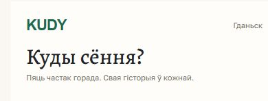

# Шрыфтавы драфт: уваход у меню-карту

Статус: упадабаны ўладальнікам драфт ад 2026-10-31, не канчатковы выбар шрыфтоў або лагатыпа. Захаваны як напрацоўка для душы KUDY. Існыя production-токены і ролі канона гэтым запісам не змененыя.

Падстава: уладальнік асобна папрасіў захаваць шрыфтавую кампазіцыю «KUDY / Гданьск / Куды сёння? / Пяць частак горада. Свая гісторыя ў кожнай» з меню-карты. Крыніца дакладных параметраў — [specimen.css](../menu-map-city-only/specimen.css), элементы `.app-top b`, `.app-top span`, `h1`, `.intro`.

| Элемент узору | Сапраўдны шрыфт у макеце | Параметры CSS |
|---|---|---|
| KUDY | Arial Bold, сістэмны шрыфт эскіза | 22 px, 700, letter-spacing −1 px, #1D6B4F |
| Гданьск | Golos Text Regular | 11 px, 400, #706D63 |
| Куды сёння? | Alegreya Medium, фактычны файл эскіза | 32 px, CSS-дэкларацыя 400, line-height 1.1, #22262B |
| Пяць частак горада. Свая гісторыя ў кожнай. | Golos Text Regular | 11 px, 400, line-height 1.5, #706D63 |

Фон узору #FFFDF9; навакольная папера #FAF7F2. Захоўваем суадносіны выразнага літаратурнага загалоўка, спакойнага дробнага тэксту і кампактнага зялёнага KUDY. Тэкст застаецца рэдагуемым і лакалізаваным.

Arial тут — фактычнае напісанне KUDY у гэтым web-драфце, не фінальны wordmark. Не падмяняць яго ў апісанні на Golos і не пераносіць аўтаматычна ў лагатып. Драфтавыя 11 px — параметр гэтага канкрэтнага ўзору, не зацверджаны мінімальны памер production-тэксту.

Файл `Alegreya.ttf` мае ўнутраны стыль **Medium**; CSS эскіза аб’яўляе яго звычайным face і задае `font-weight: 400`. Для паўтарэння менавіта ўпадабанага выгляду выкарыстоўваць захаваны файл, не падстаўляць іншы Alegreya Regular паводле адной CSS-лічбы. SHA-256: Alegreya `8cedbdcf3d41a29a81b3fc164b24d5d893f84cf5bb8e2f1c504978eaaf4497ec`; Golos Text `387c0cc0a324fb1f8289b3c1d38d31441a0311c72e52ac9b5b5062d36cc3afed`.

Лакальныя файлы шрыфтоў: [Golos Text](../menu-map-city-only/fonts/GolosText.ttf), [Alegreya](../menu-map-city-only/fonts/Alegreya.ttf). Ліцэнзіі OFL ляжаць побач у той жа тэчцы. Arial не распаўсюджваецца ў пакеце. Жывы ўзор — ніжняя частка [старонкі параўнання](index.html).
